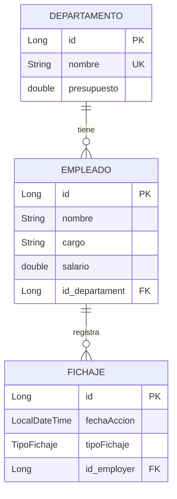

# ⏱️ Tracky - API REST de Registro de Jornada Laboral

Bienvenido a **Tracky**, un servicio web y API REST desarrollado con **Spring Boot** y **Java 17** para la gestión y control del registro horario de jornadas laborales en una empresa. Permite la administración de departamentos, empleados y el registro automático de entradas y salidas (fichajes), aplicando reglas de negocio y validaciones personalizadas.

---

## 📋 Índice
1. [Descripción General](#-descripción-general)
2. [Tecnologías Utilizadas](#-tecnologías-utilizadas)
3. [Modelo de Datos](#-modelo-de-datos)
4. [Estructura del Proyecto](#-estructura-del-proyecto)
5. [Endpoints de la API](#-endpoints-de-la-api)
6. [Reglas de Negocio y Validaciones](#-reglas-de-negocio-y-validaciones)
7. [Manejo de Errores](#-manejo-de-errores)
8. [Instalación y Ejecución](#-instalación-y-ejecución)
9. [Documentación con Swagger / OpenAPI](#-documentación-con-swagger--openapi)

---

## 📖 Descripción General

El proyecto simula el sistema de control de asistencia de una empresa, estructurado en tres entidades fundamentales:
- **Departamentos**: Unidades organizativas con nombre único y presupuesto asignado.
- **Empleados**: Trabajadores adscritos a un departamento con cargo y salario determinado.
- **Fichajes**: Registros cronológicos de marcas de entrada y salida asociadas a cada empleado.

El sistema se encarga de alternar automáticamente las marcas de tiempo entre `ENTRADA` y `SALIDA`, garantizando que no se puedan duplicar registros consecutivos del mismo tipo ni sobrepasar el presupuesto presupuestario de los departamentos al asignar salarios.

---

## 🛠️ Tecnologías Utilizadas

- **Java 17**: Lenguaje de programación base.
- **Spring Boot**: Framework principal para el desarrollo del backend.
  - **Spring Web MVC**: Construcción de controladores y endpoints RESTful.
  - **Spring Data JPA / Hibernate**: Persistencia y mapeo objeto-relacional (ORM).
  - **Spring Validation (Jakarta)**: Validaciones declarativas y validadores personalizados.
- **H2 Database**: Base de datos relacional en memoria para desarrollo y pruebas rápidas.
- **Springdoc OpenAPI / Swagger UI (v3)**: Generación interactiva de documentación de la API.
- **Lombok**: Reducción de código boilerplate (getters, setters, constructores, builders).
- **Maven**: Herramienta de compilación y gestión de dependencias.

---

## 📊 Modelo de Datos

El diseño de la base de datos consta de relaciones bidireccionales y unidireccionales mapeadas mediante JPA:



- **Departamento (1) ➔ Empleados (N)**: Un departamento agrupa múltiples empleados.
- **Empleado (1) ➔ Fichajes (N)**: Un empleado acumula un historial de marcas de entrada y salida.
- **TipoFichaje (Enum)**: Valores admitidos `ENTRADA` y `SALIDA`.

---

## 📂 Estructura del Proyecto

El código fuente se organiza siguiendo una arquitectura en capas en el paquete base `com.salesianos.tracky`:

```
Tracky/
├── src/main/java/com/salesianos/tracky/
│   ├── config/          # Configuraciones (validación, OpenAPI, etc.)
│   ├── controller/      # Controladores REST (DepartamentoController, EmpleadoController)
│   ├── error/           # Manejo global de excepciones (RFC 7807 ProblemDetail)
│   ├── model/           # Entidades JPA y Enumerados
│   │   ├── DTOs/        # Data Transfer Objects (Requests y Responses)
│   │   └── ENUM/        # Tipos enumerados (TipoFichaje)
│   ├── repository/      # Interfaces Spring Data JPA Repositories
│   ├── service/         # Lógica de negocio y servicios
│   ├── validation/      # Validaciones y anotaciones personalizadas
│   └── TrackyApplication.java # Clase principal de arranque
└── src/main/resources/
    ├── messages/        # Mensajes de validación y errores internacionalizados
    └── application.properties # Parámetros de configuración del servidor
```

---

## 🛣️ Endpoints de la API

La API responde por defecto en el puerto `8000` con el prefijo base `/api`.

### 🏢 Departamentos (`/api/departamento`)

| Método | Endpoint | Descripción | Códigos HTTP |
| :--- | :--- | :--- | :--- |
| `GET` | `/api/departamento` | Obtiene el listado de todos los departamentos. | `200 OK` |
| `GET` | `/api/departamento/{id}` | Obtiene los detalles de un departamento por su ID. | `200 OK`, `404 Not Found` |
| `POST` | `/api/departamento` | Da de alta un nuevo departamento. | `201 Created`, `400 Bad Request` |
| `PUT` | `/api/departamento/{id}` | Actualiza la información de un departamento existente. | `200 OK`, `404 Not Found`, `400 Bad Request` |
| `DELETE` | `/api/departamento/{id}` | Elimina un departamento por su identificador. | `204 No Content`, `404 Not Found` |

#### Ejemplo de Cuerpo de Petición (Crear / Actualizar Departamento):
```json
{
  "nombre": "Desarrollo de Software",
  "presupuesto": 75000.0
}
```

---

### 👨‍💼 Empleados y Fichajes (`/api/empleado`)

| Método | Endpoint | Descripción | Códigos HTTP |
| :--- | :--- | :--- | :--- |
| `GET` | `/api/empleado` | Obtiene el listado de todos los empleados. | `200 OK` |
| `GET` | `/api/empleado/{id}` | Obtiene la ficha de un empleado por ID (con historial de fichajes). | `200 OK`, `404 Not Found` |
| `POST` | `/api/empleado` | Registra un nuevo empleado asignado a un departamento. | `201 Created`, `400 Bad Request` |
| `PUT` | `/api/empleado/{id}` | Modifica los datos de un empleado existente. | `200 OK`, `404 Not Found`, `400 Bad Request` |
| `PUT` | `/api/empleado/{idEmple}/departamento/{idDepart}` | Reasigna un empleado a otro departamento. | `200 OK`, `404 Not Found` |
| `DELETE` | `/api/empleado/{id}` | Da de baja a un empleado por su ID. | `204 No Content`, `404 Not Found` |
| `POST` | `/api/empleado/{id}/fichar` | Registra un nuevo fichaje (alternando ENTRADA / SALIDA). | `201 Created`, `404 Not Found`, `409 Conflict` |
| `GET` | `/api/empleado/{id}/fichajes` | Consulta el historial completo de fichajes de un empleado. | `200 OK`, `404 Not Found` |

#### Ejemplo de Cuerpo de Petición (Crear Empleado):
```json
{
  "nombre": "Ana García",
  "cargo": "Arquitecta de Software",
  "salario": 4200.0,
  "idDepartamento": 1
}
```

#### Ejemplo de Respuesta de Fichaje (`POST /api/empleado/{id}/fichar`):
```json
{
  "fechaAccion": "2026-10-23T14:30:00",
  "tipoFichaje": "ENTRADA",
  "nombreEmpleado": "Ana García"
}
```

---

## ⚙️ Reglas de Negocio y Validaciones

1. **Control de Presupuesto Departamental (`@PresupuestoSuficiente`)**:
   - Al dar de alta o modificar un empleado, el validador personalizado comprueba que la suma de todos los salarios de los empleados de ese departamento más el nuevo salario no supere el `presupuesto` disponible del departamento.
2. **Alternancia Automática de Fichajes**:
   - Si el empleado no tiene fichajes registrados, el primer fichaje será `ENTRADA`.
   - Si el último fichaje registrado fue `ENTRADA`, el siguiente pasará automáticamente a ser `SALIDA`, y viceversa.
3. **Restricción de Fichaje Duplicado**:
   - Si se detecta un intento de registrar un tipo de fichaje consecutivo idéntico al último registrado, el sistema bloquea la acción lanzando una excepción `FichajeDuplicadoException` (HTTP `409 Conflict`).

---

## 🚨 Manejo de Errores

El proyecto utiliza un `@RestControllerAdvice` (`GlobalExceptionHandler`) que transforma las excepciones en respuestas normalizadas bajo el estándar **RFC 7807 (ProblemDetail)**:

- **`404 Not Found`**: Cuando no se encuentra la entidad buscada (`EmpleadoNotFoundException`, `DepartamentoNotFoundException`).
- **`409 Conflict`**: Cuando se produce un conflicto en el flujo de trabajo (`FichajeDuplicadoException`).
- **`400 Bad Request`**: Cuando fallan las validaciones de campos obligatorios (`@NotBlank`, `@Min`, `@NotNull`, o validaciones cruzadas).

Ejemplo de respuesta de error:
```json
{
  "type": "https://example.com/errors/not-found",
  "title": "Empleado no encontrado",
  "status": 404,
  "detail": "No se ha encontrado el empleado con ID: 99",
  "instance": "/api/empleado/99"
}
```

---

## 🚀 Instalación y Ejecución

### Prerrequisitos
- **Java Development Kit (JDK) 17** o superior instalado.
- Acceso a terminal/consola con permisos para ejecutar scripts de Maven.

### Pasos para arrancar el proyecto

1. Situarse en la carpeta del proyecto `Tracky`:
   ```bash
   cd Tracky
   ```

2. Compilar el proyecto y descargar dependencias:
   - En Windows (PowerShell / CMD):
     ```cmd
     .\mvnw.cmd clean package -DskipTests
     ```
   - En Linux / macOS:
     ```bash
     ./mvnw clean package -DskipTests
     ```

3. Iniciar la aplicación:
   ```cmd
   .\mvnw.cmd spring-boot:run
   ```

4. La API estará disponible y escuchando en:
   ```
   http://localhost:8000
   ```

---

## 📑 Documentación con Swagger / OpenAPI

Con la aplicación en ejecución, puedes explorar, interactuar y probar todos los endpoints directamente desde tu navegador:

- **Swagger UI**: [http://localhost:8000/swagger-ui/index.html](http://localhost:8000/swagger-ui/index.html)
- **Especificación OpenAPI (JSON)**: [http://localhost:8000/v3/api-docs](http://localhost:8000/v3/api-docs)
- **Consola de Base de Datos H2**: [http://localhost:8000/h2-console](http://localhost:8000/h2-console)
